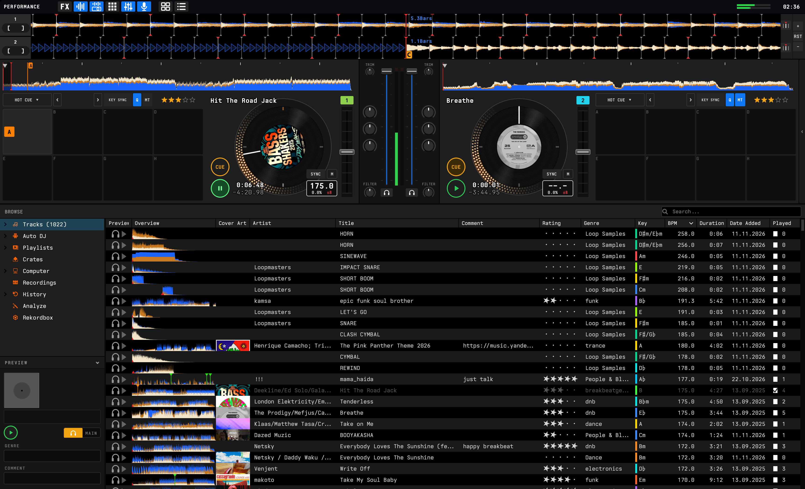
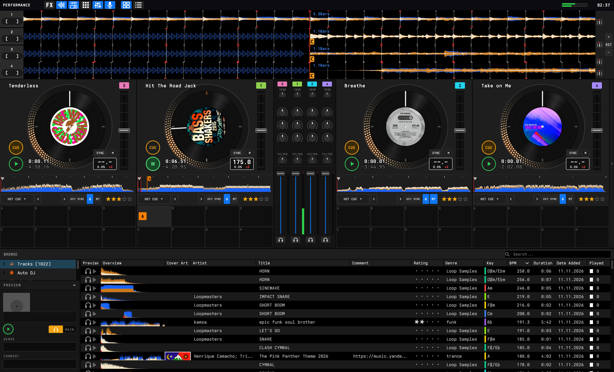

# kamsa

A [Mixxx](https://mixxx.org) skin with a performance layout: big vinyl platters with the deck readout drawn on the platter, rekordbox-style waveforms and beat grid, a center mixer and a browser with a preview deck. It is a fork of [Rekordmixxx](https://github.com/CypherJack/rekordmixxx).

The skin uses a few widget options that upstream Mixxx doesn't have yet. They ship here as one patch, [`mixxx-patch/kamsa-skin-options.patch`](mixxx-patch/kamsa-skin-options.patch), for one exact Mixxx commit. Unpatched Mixxx still loads the skin but ignores those options, so the platters come out empty. For unpatched Mixxx, use **[kamsa (stock)](https://github.com/v1vendi/kamsa_mixxx_skin_stock)** instead.





## Features

- Global bar with toggles for FX, waveforms, samplers, mixer, microphones, the 4-deck layout and the maximized library
- Stacked rekordbox-style waveforms with a bar-numbered beat grid
- Player decks:
  - platter that turns once per bar, with beat ticks, a strobe and a tempo ring
  - title, artist, time, BPM, and CUE / PLAY / SYNC / M drawn on the platter
  - overview waveform with lettered hotcue markers
  - colored hotcue chips
  - slim tempo fader
- Center mixer for 2 or 4 channels
- Sampler deck, effects panel, and a library side panel with a preview deck. Genre and comment fields there open for editing on the first click.
- Dark and Amber color schemes

## What the patch adds

The patch applies to Mixxx `main` at [`dc4bf99322`](https://github.com/mixxxdj/mixxx/commit/dc4bf99322bb9a4c59483d24c2c40d1df2d1b726) from 2026-11-15 (`2.6-beta-3831-gdc4bf99322`). It only adds skin options, and every new option is off by default, so other skins behave as before.

| Widget | Skin options |
| --- | --- |
| `Spinny` | `BeatJog` platter, `DeckReadout` overlay, `TempoRing`; skips redrawing unchanged frames (this needs the vsync PLL window to be updated after the swap, which the patch also changes) |
| `Visual` (waveform) | `WaveformStyle` rekordbox, `WaveformAttack` / `WaveformRelease`, `BeatGridStyle`, beat and bar marker colors and sizes, `BarsLabel*`, `BarColor` |
| `Overview` | `HotcueLetterLabels`, `TopHalfOnly`, `LowBandInFront`, `Smoothing`, `BandGains`, `StackBands`; cue markers in library overviews |
| `HotcueButton` | `ChipStyle` |
| `StarRating` | `HollowStars` |
| `SliderComposed` | `JumpToClick` |
| `TrackProperty` | `EditOnClick`; `genre` becomes editable |
| Engine | `[ChannelN],bar_beat_position` control for the beat-jog platter |

## Install

### 1. Build the patched Mixxx

Check out the pinned commit and apply the patch:

```sh
git clone https://github.com/mixxxdj/mixxx.git
cd mixxx
git checkout dc4bf99322bb9a4c59483d24c2c40d1df2d1b726
git apply /path/to/kamsa_mixxx_skin/mixxx-patch/kamsa-skin-options.patch
```

Set up the build environment once. This downloads Mixxx's prebuilt dependencies or installs the system packages:

| Platform | Command |
| --- | --- |
| macOS | `source tools/macos_buildenv.sh setup` |
| Debian / Ubuntu | `tools/debian_buildenv.sh setup` |
| Fedora | `tools/rpm_buildenv.sh setup` |
| Arch | `tools/archlinux_buildenv.sh setup` |
| Windows | `tools\windows_buildenv.bat` |

Build:

```sh
mkdir build && cd build
cmake .. -DCMAKE_BUILD_TYPE=RelWithDebInfo
cmake --build . --parallel
```

On macOS, run the `source tools/macos_buildenv.sh setup` line in each new shell before you run `cmake`. For anything else, see Mixxx's [CONTRIBUTING.md](https://github.com/mixxxdj/mixxx/blob/main/CONTRIBUTING.md) and the [build wiki](https://github.com/mixxxdj/mixxx/wiki#compile-mixxx-from-source-code).

Start Mixxx from the build folder: `./mixxx` (or `mixxx.exe` on Windows).

### 2. Install the skin

Clone or copy this repository into your Mixxx user skins directory:

| OS | Skins directory |
| --- | --- |
| macOS (sandboxed build) | `~/Library/Containers/org.mixxx.mixxx/Data/Library/Application Support/Mixxx/skins/` |
| macOS (other builds) | `~/Library/Application Support/Mixxx/skins/` |
| Linux | `~/.mixxx/skins/` |
| Windows | `%LOCALAPPDATA%\Mixxx\skins\` |

```sh
git clone https://github.com/v1vendi/kamsa_mixxx_skin.git "<skins directory>/kamsa"
```

Restart Mixxx. Then choose **kamsa** under Preferences → Interface → Skin. Pick a waveform type that uses the filtered renderer (the default, *Filtered*) to get the rekordbox waveform.

## License

CC BY-SA 4.0. Based on Rekordmixxx by its contributors. All artwork is original vector art made for this skin.

The Mixxx patch is under Mixxx's license, GPL-2.0-or-later.

"rekordbox" is a trademark of AlphaTheta Corporation. This skin is not affiliated with AlphaTheta.
